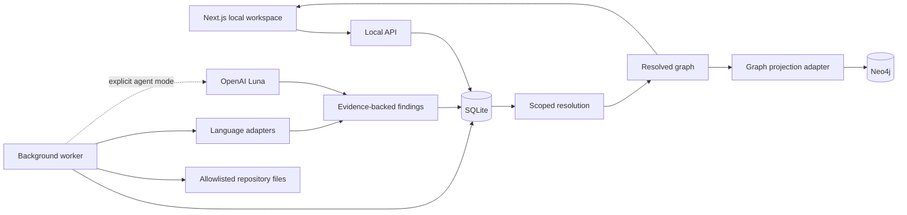

# Graphifier design

## Purpose and scope

Graphifier builds evidence-backed data lineage from local repositories. Users can follow a dataset or column upstream to understand its origin, or downstream to explore potential change impact. The initial languages are SAS, SQL, Python, and Shell. SAS models refer to statistical training and scoring, not merely program files.

The product preserves incomplete knowledge. Static code describes possible behaviour; it does not prove that a job ran, which runtime branch ran, or which model artifact was deployed. Missing dependencies and unresolved expressions must remain visible.

This document describes the architecture and intended extension contracts. See `IMPLEMENTATION.md` for the delivered scope and explicit gaps, `../backend/API.md` for actual request shapes, and `EXTENDING.md` for development recipes. Future design concepts below must not be interpreted as already implemented APIs.

## System boundary



The web server, API, and worker run locally. SQLite is the durable source of truth. Neo4j is a rebuildable projection, not a second authority. The API is the shared interaction boundary for browser users and external agents.

Source repositories are read-only inputs. Graphifier must never execute source, shell scripts, SAS programs, or imported Python modules. Selecting agent mode sends bounded source excerpts to the configured OpenAI endpoint; local persistence does not imply local inference. API credentials stay in server-side environment variables.

## Three layers of knowledge

### 1. Source observations

Store original references, expressions, source locations, extraction method, and the indexed source identity. An observation such as `&target_lib..customer_scores` remains intact even after it resolves to a physical table. Avoid replacing the original expression with a guessed value.

Evidence belongs to individual findings and relationships. It should identify repository, indexed revision or content hash, file, and line range. A file hash is necessary even when Git metadata exists because a working tree may contain uncommitted changes. The source shown to a user must correspond to the indexed snapshot, not silently show newer live content.

### 2. Resolution decisions

A resolution binds a symbolic name in a declared scope and environment. Decisions have an actor, lifecycle state, rationale where supported, and a version. A proposal can be previewed, applied with an expected version, and retracted. A stale request must not overwrite a newer decision.

The initial implementation focuses on repository/environment symbol bindings. The broader design admits namespace aliases, reference-level asset links, manually supplied dependencies, and scenario-only overrides. Those require separate action types and validation rather than being overloaded into strings.

### 3. Materialized lineage

Apply compatible bindings to source expressions, then derive graph identities and relationships. Keep unresolved references as distinct nodes. Shared physical identity requires sufficient system and environment context; matching the bare table name is never enough to prove equivalence.

Changing a binding changes a projection, not the original evidence. Retraction should restore the previous unresolved state or the remaining applicable binding. Conflicting bindings must be surfaced rather than resolved through arbitrary list order.

## Domain model

| Object | Meaning | Identity considerations |
|---|---|---|
| Repository | Local source collection | Stable registration ID; local path is not a physical dataset identity |
| Indexed snapshot | Source observed during a job | Content identity plus available Git revision |
| Program | Executable source definition | Repository + path + source evidence |
| Dataset reference | A read or write in source | Preserve symbolic expression and lexical scope |
| Dataset asset | Resolved table/file/data collection | System + environment + namespace + name |
| Column | Field belonging to a dataset | Parent dataset + column name; version where available |
| Transformation | Calculation or row-shaping step | Source location + expression; multiple inputs and outputs |
| Statistical model | Training/scoring definition or artifact | Distinguish definition from trained artifact/version |
| Symbol | Unresolved/configurable variable | Repository + language scope + environment |
| Resolution | Attributed interpretation | Proposal ID + optimistic version |

Source IDs and physical asset IDs serve different purposes. Do not merge all source nodes simply because they share a display label. Temporary SAS `WORK` datasets should eventually include invocation scope; a global `WORK.CUSTOMERS` identity is incorrect.

## Transformation semantics

Represent calculations as nodes so explanations, expressions, and evidence travel together:

```text
transactions.amount ------\
                          -> currency conversion -> aggregation -> total_aud
fx_rates.exchange_rate ---/
```

Value dependencies differ from row-selection dependencies. A filter column, join key, grouping key, and value input may each influence a result in different ways. The adapter contract should expose the role in relationship attributes when known. Unsupported semantics should produce coverage warnings, not fabricated column-level certainty.

Training lineage should distinguish training data, feature construction, target, training operation, model definition/artifact, scoring inputs, scoring operation, and predictions. Source-only extraction cannot establish which trained binary was deployed. Runtime manifests or logs are a future evidence source.

## Extraction workflow

1. Register a folder under the configured repository root.
2. Queue a job with repository, environment, and explicit agent-mode selection.
3. A separate worker claims work and inventories supported files within configured limits.
4. Language adapters emit entities, relationships, symbols, and coverage warnings.
5. Optional Luna enrichment investigates bounded context and returns structured findings.
6. Validate shapes, source locations, and relationship endpoints before accepting findings.
7. Persist a coherent completed snapshot; failed or cancelled work must not masquerade as a complete graph.
8. Apply scoped resolution decisions when serving a lineage view.
9. Explicitly synchronize the projection to Neo4j when configured.

Language adapters share an intermediate representation. Parsing offers reliable anchors for supported patterns; an LLM adds interpretation, never proof of runtime execution. Output from source and agents is untrusted data. Repository comments cannot authorize tool execution or expand the scan root.

## Human and agent resolution workflow

```text
List unresolved symbols
  -> inspect expressions and evidence
  -> propose binding for repository/environment
  -> preview graph changes and conflicts
  -> apply using expected version
  -> inspect updated lineage
  -> retract if wrong
```

Both users and external agents use the same API. A UI-only correction would be inaccessible to automation; direct Neo4j editing would be lost during projection rebuilds. Therefore all lasting decisions belong in SQLite through the resolution service.

Actor attribution is an audit aid in this local application, not proof of identity. Production multi-user access needs authenticated principals, role enforcement, and permission-controlled environments. An external agent should operate through a token when configured. Proposal-only versus apply permissions are a planned policy boundary, not something a client-supplied actor string can enforce.

## Cross-repository stitching

Example: a SAS producer writes `&target_lib..customer_scores`, while a Python consumer reads `{input_schema}.customer_scores`. Bind each symbol within its own repository and the same environment/physical namespace. Only then should both resolve to the same asset.

Do not infer equivalence from similar names alone. Connection hosts, databases, schemas, storage prefixes, and deployment environments matter. Parameterized file families such as `/raw/${business_date}/customers.csv` represent partitions or instances; a collection-level relationship is different from a particular file identity.

Explicit asset-equivalence decisions are a useful extension when source configuration is unavailable. Such decisions should preview merges and retain their own evidence and lifecycle.

## Graph projection

The Neo4j adapter receives a normalized graph, not arbitrary model-generated Cypher. Writes use parameterized queries and stable IDs. Projection ownership must be explicit so Graphifier never deletes unrelated graph data. A successful sync is recorded only after the transaction succeeds. The local graph remains available when Neo4j is absent or unavailable.

For larger deployments, prefer immutable projection generations and an active-generation pointer. This supports atomic publication, failed-sync recovery, rollback, and readers that never see half a refresh. A transactional outbox can decouple resolution commits from graph sync. These are scaling extensions unless listed as delivered.

## Exploration and impact

Upstream traversal answers where a value or dataset may originate. Downstream traversal answers what may be affected by a change. Both should expose edge kinds and evidence. Graph reachability is potential impact, not a proof of changed runtime output. Unsupported dynamic calls, missing repositories, and unresolved names make a result incomplete.

Focus the UI on a chosen asset, then expand neighbours. Show model and transformation nodes, allow filtering, and place evidence beside the selected element. Do not require users to interpret an entire estate-sized graph at once.

## Operational constraints

- Bind services to loopback for the local deployment.
- Resolve real paths and enforce the configured root, including symlink escapes.
- Exclude credentials, dependency directories, generated output, and oversized files.
- Bound file counts, request sizes, model calls, and model timeouts.
- Keep API keys and database credentials out of browser bundles, logs, and source control.
- Report API failure and partial coverage honestly; never label a static-only fallback as successful agent analysis.
- Keep completed source evidence available after the live repository changes.
- Back up SQLite before schema migrations; rebuild Neo4j from the durable local state.

## Open design choices

Before an enterprise rollout: define canonical system/connection naming; decide who may apply shared mappings; choose runtime evidence sources; decide retention and source-code handling policy; and evaluate language coverage against representative repositories. These decisions should remain visible rather than be hidden in heuristics.
